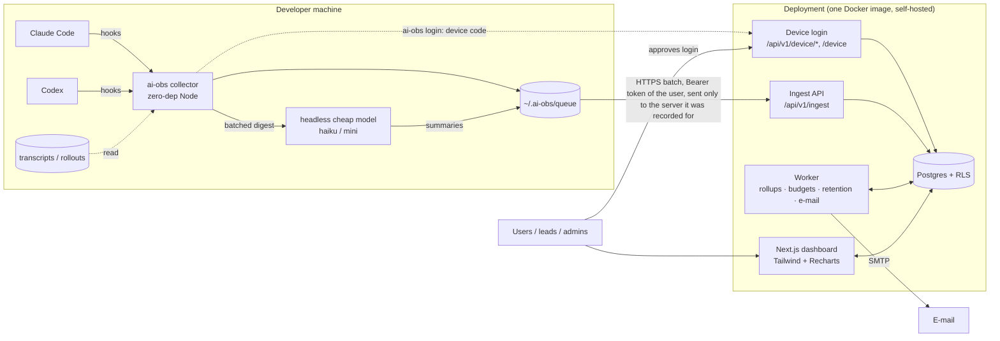

# Architecture

Architecture of the self-hosted AI observability tool (one deployment per company, ADR-0028). Requirements and scope: [BRIEF.md](BRIEF.md).
Reasons behind each choice: [docs/adr/](docs/adr/README.md).

## Components

| Component | Path | Responsibility | Notes |
|---|---|---|---|
| **Collector** (`ai-obs`) | `packages/collector` (npm `@soukupl/ai-obs`, command `ai-obs`) | Hook handlers per harness; parse transcripts incrementally; classify phases and outcomes; build events; local queue; send; local summaries; `login` (device code or pasted token), `link` (dot file) | Hook handlers write a job and spawn a detached worker (in-process budget under 100 ms from hook entry, including the dot-file lookup). The worker pins each session once to a queue stream (project key + server + team slug); the sender sends each stream to its server with that server's token, hashes names with that server's settings and holds streams without a usable server. SessionStart prints a nudge only from local files (ADR-0030). One token per server. Zero runtime deps. Adapter per harness. |
| **Harness adapter** | `packages/collector` (one module per harness) | Maps a harness's hooks + transcript format into the neutral event format; returns the SessionStart nudge text (JSON for Claude Code, plain text for Codex) | `claude-code`, `codex` in v1. New harness = new adapter only. |
| **Ingest API** | `apps/web/src/app/api/v1/ingest`, `…/collector-config`, logic in `apps/web/src/lib/ingest`; format in `packages/protocol` | Authenticate token (negative cache + failed-auth IP budget before any DB call), validate (wire schema, then server-side value limits, retention-window and normalisation), de-duplicate by `event_id` (keys namespaced by sender), resolve user / team (admin mapping, then the session's dot-file team if the user is a member, then the primary team; a refused team comes back as a per-batch `warnings[]` entry) / project / machine, upsert sessions, turns, runs under an ownership rule, apply patch events, keep each session's live status (`turn_started`) | Runs under a dedicated insert-only DB role. A patch (`turn_outcome` / `turn_summary`) that arrives before its turn is parked in `pending_turn_patches` (with its sender) and applied when the turn arrives, only onto an ownerless or same-owner turn; a patch never creates a turn. A `session_title` patch before its session is parked the same way in `pending_session_patches` (ADR-0026). An existing turn / run / session can be overwritten only by its owner. `turn_started` creates an unknown session on the fly and may re-open a resumed one; migration 0017 adds `SELECT` on `current_turn_started_at`, `last_seen_at` and `ended_at` and `UPDATE` on the first two to `app_ingest`, on top of its identity columns; `started_at`, `title` and `end_reason` stay unreadable (ADR-0027). |
| **Dashboard (web)** | `apps/web` (`@ai-obs/web`): header with the deployment name, `/device` approval page, views `src/app/(dashboard)/{overview,projects,models,phases,agents,flows,skills-mcp,sessions,turns,tokens}`, print-ready flow report `src/app/report/flows`, queries `src/lib/queries`, components `src/components`, CSV `src/app/api/export`, auth `src/lib/auth` | Server-rendered pages + route handlers for charts, CSV export and the polled live-status JSON (`src/app/api/live/sessions`, `src/lib/live/status.ts`); the Agents page groups agent types and draws the git-graph timeline (`components/charts/AgentGraph.tsx`, also on the turn page) whose runs link to their flow's section on its turn page; the Overview lists runaway turns, long / complex flows and the ingest statistics; stacked-area charts zoom client-side (drag) | Every request runs in a transaction that sets the RLS context (`withDashboardContext`; user id and member role). Short ranges read raw turns, long ranges (and ranges starting before the retention cutoff) `daily_rollups`; medians on long ranges come from raw turns while they still exist. Sends anti-framing headers (`frame-ancestors 'none'`). |
| **Admin console** | `apps/web/src/app/admin`, `src/lib/admin` | Settings (name, visibility, naming, retention, runaway thresholds), teams, members, invitations, projects (mapping overrides the repository's dot file), budgets, audit log, tokens (every token, with revoke), service users, model prices; "My tokens" for everyone | Admins (leads: budgets only). Every write runs in `withUserDb` and appends an `audit_log` row. Removing a member deletes their team memberships and revokes their tokens, but keeps their recorded activity ("former member"). Also hosts the public device-login routes (`/api/v1/device/code`, `/token`, rate-limited per IP). |
| **Worker** | `apps/worker` (`@ai-obs/worker`, jobs in `src/jobs`) | Rollups (every few minutes; `daily_rollups` and `daily_skill_mcp_rollups` in one slice transaction, split by outcome), runaway detection + hourly digests (every 5 min, ADR-0018), budget checks (hourly), retention + anonymization (nightly), e-mail; settings from the single `deployment` row | Same image, different entry point. |
| **Postgres** | `docker-compose.yml` service `postgres`; schema in `packages/db` | Single source of truth; RLS for user, team and role isolation | Plain Postgres 16+, no vendor data APIs. |
| **Migrate** | `packages/db` (`src/migrate.ts`, `migrations/`) | One-shot: Drizzle migrations incl. DB roles / RLS policies (`0001_roles_rls.sql`), the pending-patch table + indexes (`0002_pending_patches.sql`), price fallback and stable turn-list order (`0003_price_fallback_turn_list_order.sql`), and the review hardening: invitation consent, token membership, team-bound attribution, project salt, platform scope (`0004_auth_invites_salt_hardening.sql`), skill / MCP usage columns, rollup table and aggregate functions (`0005_skills_mcp.sql`), effort advisor (`0006`), outcome-split rollups + wasted-spend functions (`0007`), skill impact (`0008`), MCP reliability (`0009`), runaway alerts (`0010`), agent groups + timeline functions (`0011`), run stages / flow keys, `run_links` + link functions (`0012`), flow list functions `agg_flow_runs` / `agg_flow_links` and skills / MCP on `agg_turn_runs` (`0013`), company memberships and the clean-break revocation of every earlier token (`0014`), personal flow flags + `agg_ingest_stats()` (`0015`), session titles (`0016`), live session status columns, index and `app_ingest` column grants (`0017`), one deployment per company: the `deployment` row, `memberships`, user kinds, token expiry / source / label, `teams.slug`, `device_codes`, RLS rewritten around users and teams, `app_platform` stripped of every privilege (`0018`, ADR-0028..0030) | Runs before `web` and `worker` start. |

Shared code: `packages/protocol` (`@ai-obs/protocol`) holds the ingest schema v1 (types, zod schemas,
constants, fixtures) used by the ingest API and, type-only, by the collector; `packages/db` (`@ai-obs/db`)
holds the Drizzle schema, migrations, roles + RLS SQL, the `withRlsContext()` helper and the one-off dev merge script (`db:merge-companies`).

All backend services run as Docker containers defined in one Compose file (`web`, `worker`, `migrate`,
`postgres`, plus `mailpit` in the dev profile). The collector is not containerized; it runs on the
developer's machine inside the harness.

## Data flow

0. **Login.** `ai-obs login --server <url>` asks `POST /api/v1/device/code` for a device code, prints `Open <server>/device and enter the code`, and polls `POST /api/v1/device/token`. The user approves at `/device` (signed in, own login only); the exchange mints a 90-day user token (source `device`, label = client name) through a `SECURITY DEFINER` function, and the collector stores it in `config.json` under that server. A pasted token (source `manual`) works the same way.
1. Harness fires a hook (`UserPromptSubmit`, `Stop`, `SubagentStop`, `SessionEnd`, …) → collector handler records the
   event and spawns the worker. A main-agent `UserPromptSubmit` becomes a `turn_started` event (ADR-0027). On `SessionStart` it may also print a nudge (from local files only): no dot file with two or more servers, the dot-file server without a usable token, a token expiring within 14 days, dropped events, the server ignoring the repository's dot-file team (latest ingest warning).
2. Worker reads the transcript from the stored cursor, builds `turn` / `run` events (tokens de-duplicated
   per API response, phases, provisional outcome), appends them to the queue.
3. Next turn or session end → `turn_outcome` patches (correction signals); a batched headless call produces
   `turn_summary` patches once ten turns wait, the oldest has waited ten minutes, or the session ends (ADR-0023); the hook job only stages those digests, and the worker summarises them after its flush, under `summaries.lock`, then sends the summaries in a second flush (ADR-0027). Each session is pinned once to a queue stream (project key, server, dot-file team slug); the dot file (`.ai-obs.json`, overridden by `.ai-obs.local.json`) is read at the session's first hook, and `session_start.project.team` carries its team.
4. Queue is flushed per stream in batches (≤ 500 events / 1 MB) with the token of the stream's server; held streams (no
   server, rejected token) are skipped and names are hashed per server. Failures stay queued and are retried on the next
   flush; the server ignores already-seen `event_id`s.
5. Ingest authenticates the token (revoked, expired or without membership means 401), stores events (a patch that is ahead of its turn waits in `pending_turn_patches`) and resolves the **team** once, at `session_start`: the admin's project → team mapping, else the dot-file team if the user is a member of it (otherwise a `team_not_member` / `team_unknown` warning in the response, which the collector shows in `status` / `doctor`), else the user's primary team, else none. Attribution is always the token's user.
6. Worker folds new turns into `daily_rollups` (keeping a deleted user's rows and never rebuilding a day whose raw turns are partly gone); long-range charts read rollups, short-range and
   detail views read `turns` / `runs`.
7. The dashboard polls `/api/live/sessions` every 10 s while a tab is visible (the "Active now" strip on `/sessions`, the live session page). The routes read `agent_sessions` under the same RLS context as the pages; the working / idle / stale status comes from `current_turn_started_at` and `last_seen_at`, which ingest keeps from `turn_started`, `turn`, `session_start` and `session_end` (ADR-0027). `ai-obs live` shows the same on the machine from local files only.

## Isolation and access

- There is one company per deployment, so rows carry no company column. RLS is enabled **and forced** around users and
  teams (ADR-0028): the web app sets `app.user_id` and `app.role` (member role `admin` or `member`) with `SET LOCAL` inside each
  transaction (`withRlsContext()`), the ingest role sets `app.user_id` of the token's user (`withIngestContext()`); RLS policies
  filter on them. The DB re-checks the claims: `app_user()` returns the id only while that user has a membership, and
  `app.role = 'admin'` counts only if `memberships.role` agrees. Team-lead rights are derived from `team_memberships`,
  never passed in. Ingest policies add `WITH CHECK user_id = app_user()`, so a token holder writes only their own rows.
- Policies: member → own rows; lead → rows of teams they lead (full-detail mode) or aggregates
  without `user_id` (aggregates-only mode); admin → all rows under the same mode rule.
- Aggregate access goes through `SECURITY DEFINER` functions (`agg_*`, owned by the NOLOGIN role
  `app_definer`) that never return `user_id` or names. Token lookup, team resolution (`ingest_team_status`), device login
  (`device_*`) and login provisioning (`auth_*`) are definer functions too.
- DB roles: `app_web` (RLS-bound), `app_ingest` (insert / patch telemetry of the token's user, identity-column reads only,
  token lookup function), `app_worker` (rollups, budgets, retention), `app_definer` (owner of the definer functions). There
  is no platform role and no super admin. Services connect via `dbFor()` (ADR-0014); details in `packages/db/README.md`.

## Domain model

| Term | Meaning |
|---|---|
| **Deployment** | The one company this installation serves (table `deployment`, exactly one row): name, slug, settings (individual-visibility mode, project-naming mode, retention, runaway thresholds) and the project salt. There is no tenant above it (ADR-0028). |
| **Team** | Group of members. Has an immutable `slug` (the id used in dot files). A turn is attributed to at most one team. |
| **User** | One identity, `person` (login, e-mail, name) or `service` (admin-made, no login, no e-mail, a name and a primary team; holds tokens for CI, bots and shared machines). |
| **Membership** | A user's place in the deployment (`memberships`): role `admin` or `member` and a primary team. Team memberships and per-user budgets hang off it. Removing it revokes the person's tokens and keeps their recorded activity. |
| **Ingest token** | Secret used by the collector (`aiobs_u_`), always one user's. `source` is `device` (made by `ai-obs login`, fixed 90-day expiry, label = client name) or `manual` (made on "My tokens", or by an admin for a service user; lifetime 30 / 90 / 365 days or none). Users see and revoke their own, admins every token. Revoking is one-way; an expired token answers 401 like a revoked one (ADR-0029). |
| **Device code** | A short-lived (10 min) pairing between a CLI login and a browser approval (`device_codes`): hashed device code, 8-letter user code, client name, requester IP, status. Approved by a signed-in person at `/device`, exchanged once for a token (ADR-0029). |
| **Machine** | A developer computer, identified by a random ID generated at install. |
| **Harness** | The AI coding tool (Claude Code, Codex, …). |
| **Project** | A codebase, keyed by normalized git remote (or its hash). Optionally mapped to a team. |
| **Project dot file** | `.ai-obs.json` at a repository's top level (committed): `{ "server": "<url>", "team": "<team slug>" }`, written by `ai-obs link`. `.ai-obs.local.json` (git-ignored) overrides it per key. Holds no secret; the collector sends only to servers it holds a token for (ADR-0030). |
| **Team resolution order** | Decided by the server once per session, at `session_start`: the admin's project → team mapping, else the dot-file team (`session_start.project.team`) if the user is a member of it, else the user's primary team, else none. A dot-file team the user is not in, or that does not exist, falls through with a `team_not_member` / `team_unknown` warning in the ingest response (ADR-0030). |
| **Stream key** | The queue's unit: (project key, server endpoint, team slug or empty), directory `queue/p/s-<id>/`. A session is pinned to its stream at its first hook, so a dot file changed mid-session never retargets it. |
| **Session** | One harness session from start to exit (`agent_sessions`, the id `claude --resume` takes); groups turns and, through them, their runs, workflows and flows. Its span ends at its last run, since workflow agents outlive their turn. Listed at `/sessions`, detail `/sessions/<id>`; titled by the harness title (`session_title`, custom over AI) else the first turn summary (ADR-0026). Has a **live status** while it is not ended: *working* (`current_turn_started_at` set by `turn_started` and not yet cleared by a turn that ended at or after it), *idle* (waiting for the next prompt), or *stale* (working for over 2 h, or idle with no signal for 30 min; `last_seen_at` is the newest event time) (ADR-0027). |
| **Turn** | Primary unit of work: one user prompt and everything the agent does until it stops. |
| **Run** | One agent execution inside a turn: the main agent or a sub-agent, linked by `parent_run_id`. |
| **Agent group** | The logical kind of a sub-agent run (`Explore`, `workflow:review`): the collector's `agent_group`, else derived from `agent_type` by the one rule in `apps/web/src/lib/queries/agent-groups.ts` (ADR-0019). |
| **Orchestration** | The batch / workflow run that launched a sub-agent (`orchestration_id`, e.g. a `wf_…` id) (ADR-0019). |
| **Agent timeline** | Git graph over time on the Agents page: one lane per session, coloured by project; turns are the trunk, runs branch off their parent and merge back. One UTC day window (`day`, `fromH` / `toH` as HH:MM in the URL) (ADR-0019). |
| **Stage** | The ordinal of a workflow agent's phase inside its orchestration (`runs.stage_index`, from the journal's launch order); a row in the agent flow (ADR-0020). |
| **Flow key** | The item a workflow agent works on, from the label convention `<stage>:<item>` (`runs.flow_key`, slugged) (ADR-0020). |
| **Run link** | A directed edge between two runs of one turn whose result fed the later one (`run_links`, carried by the target run): `item` (same orchestration and flow key, consecutive stages) or `sequence` (Agent-tool siblings, the later one started after the earlier ended; also derived on read) (ADR-0020). |
| **Agent flow** | The chart of one flow in its section of the turn page: one lane whose rows are the flow's stages, pills = runs over time, arrows = run links (ADR-0020, ADR-0025). |
| **Flow** | At least two sub-agent runs of one turn that form one piece of work: a Workflow-tool run (orchestration), a turn's legacy `workflow:*` runs, or Agent-tool runs connected by run links. Computed on read (`buildFlows`), listed at `/flows`; its detail is a section of its turn's page, `/turns/<id>#flow-<key>` (ADR-0020 amendment, ADR-0025). |
| **Flow flag** | A personal bookmark of one flow (`flow_flags`: user × turn × flow key, name snapshot, note). Only its owner sees it; listed on `/flows` regardless of the date range (ADR-0024). |
| **Flow report** | The print-ready page of one flow (`/report/flows/<turnId>/<key>`); "Download PDF" is the browser's print-to-PDF (ADR-0024). |
| **Complex flow** | A flow with ≥ 5 steps, ≥ 20 min or ≥ 1 M tokens, highlighted on the Overview (ADR-0024). |
| **Ingest statistics** | Deployment-wide counts of received events by type (24 h / 7 d) and the last receipt, from the `ingest_events` ledger via `agg_ingest_stats()` (ADR-0024). |
| **Usage** | Token counts for a run, split per model × effort. |
| **Skill use** | A skill run in a turn or run, by skill name: started by the model (Skill tool; Codex: reading its SKILL.md) or typed by the user (`/name`). Names follow the project-naming mode (ADR-0016). |
| **MCP call** | A call to an MCP server's tool, counted per server × tool. Names follow the project-naming mode (ADR-0016). |
| **Phase** | Category of time inside a run: thinking, exploring, coding, documenting, testing, validating, other. |
| **Outcome** | success / failed / abandoned / unknown, derived from signals; may be revised by a later patch. |
| **Summary** | ≤ 140-char description of a turn, generated locally by a cheap model during the session (batches of ten, ten-minute wait, or session end; ADR-0023). |
| **Rollup** | Daily aggregate per team / user / project / harness / model / effort; skill uses and MCP calls have their own daily rollup per skill / server / tool. |
| **Budget** | Monthly token or estimated-cost limit for a team or user; notifies, never blocks. |
| **Wasted spend** | ≈ Cost of turns whose outcome is failed or abandoned (ADR-0017). |
| **Runaway** | A finished turn far above its user's normal tokens, or over the deployment's ≈ cost / duration threshold; one alert per turn, mailed in an hourly digest (ADR-0018). |
| **Invitation** | A pending offer to join the deployment in a team with a role (`invitations.role`). Accepted automatically at the invitee's first magic-link or OAuth login, with a one-time notice naming the visibility mode. Without an invitation a new e-mail joins only as an admin (listed in `ADMIN_EMAILS`) or as a member (domain in `ALLOWED_EMAIL_DOMAINS`). |

## Collector files

- `~/.ai-obs/config.json` (mode 0600, v3): `servers[]` (endpoint, token, e-mail, deployment name / slug, label, `expires_at`, `source`,
  `added_at`), `machine_id`, `created_at`. One entry per server (origin); a token is only ever sent to its own endpoint. A v2 file is
  migrated on first load: user-token entries become server entries, company-token entries are dropped with a message, routing
  epochs and other v2 bookkeeping are discarded. Malformed entries are kept, not erased.
- `~/.ai-obs/projects.json` is no longer read; the migration renames it to `projects.json.v2`. The v2 → v3 migration also keeps the old
  config as `~/.ai-obs/config.json.v2` (backup).
- `~/.ai-obs/queue/set-aside/<ulid>/{p,u}/<stream>` (with `about.json`): streams `ai-obs login` sets aside, never sent, when a login switches
  the account on a server.
- In each repository: `.ai-obs.json` (committed) and `.ai-obs.local.json` (git-ignored), the dot file, `{ server, team }`; the lookup
  walks from the working directory up to the directory that holds `.git`, first hit wins, no git call.
- `~/.ai-obs/queue/p/s-<id>/` with `stream.json` `{ key, endpoint, team }`: one stream per project key, server and team slug.
  `endpoint ''` means no server chosen yet; such a stream is held (`no-server`) unless exactly one server is registered. `queue/u/`
  holds streams whose project key could not be resolved yet. 0.4 `t-` / `o-` streams are re-bound on migration; the files of the 0.1.x
  collector (`queue/*.ndjson`) stay in `queue/dead/pre-upgrade/` and are never sent.
- `~/.ai-obs/state/`: `delivery.json` (per server, keyed by host: `blocked` after 401 / 403, failures, backoff) and `collector-config/<host>.json`
  (the server's naming mode, salt, teams and token expiry); `warnings.json` (the latest `team_not_member` / `team_unknown` per project, shown
  by `status` / `doctor`); `dot-files.json` (cache of the dot-file lookup, written by the worker, read by the hook); the cwd → project key
  cache the hook reads, per-session adapter state (with the pinned stream), the SessionStart markers.
- `~/.ai-obs/summaries.lock`: held by the worker's summary phase (or `ai-obs flush`) while it runs the model call; separate from `worker.lock`, so hooks and sends are not blocked by it (ADR-0027).
- `~/.ai-obs/state/summaries/staged/<harness>/<ulid>.json` (0600): digests due for a summary, written by the hook job before the session state forgets them and removed after the summaries are queued. `state/summaries/<harness>.json` keeps the ones whose summary failed. Local only.
- Routing (which server and team a stream goes to, which streams are held) lives in `packages/collector/src/routing.ts`; the sender
  re-reads it before every POST. Details: `packages/collector/README.md`, ADR-0030.
