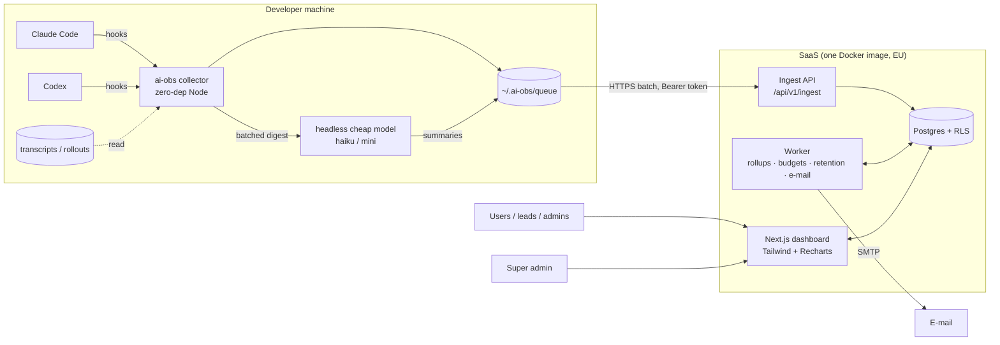

# Architecture

Architecture of the AI observability SaaS. Requirements and scope: [BRIEF.md](BRIEF.md).
Reasons behind each choice: [docs/adr/](docs/adr/README.md).

## Components

| Component | Path | Responsibility | Notes |
|---|---|---|---|
| **Collector** (`ai-obs`) | `packages/collector` (npm `ai-obs`) | Hook handlers per harness; parse transcripts incrementally; classify phases and outcomes; build events; local queue; send; local summaries | Hook handlers return < 100 ms and spawn a detached worker. Zero runtime deps. Adapter per harness. |
| **Harness adapter** | `packages/collector` (one module per harness) | Maps a harness's hooks + transcript format into the neutral event format | `claude-code`, `codex` in v1. New harness = new adapter only. |
| **Ingest API** | `apps/web/src/app/api/v1/ingest`, `…/collector-config`, logic in `apps/web/src/lib/ingest`; format in `packages/protocol` | Authenticate token (negative cache + failed-auth IP budget before any DB call), validate (wire schema, then server-side value limits, retention-window and normalisation), de-duplicate by `event_id` (keys namespaced by sender), resolve user / team / project / machine, upsert sessions, turns, runs under an ownership rule, apply patch events | Runs under a dedicated insert-only DB role. A patch (`turn_outcome` / `turn_summary`) that arrives before its turn is parked in `pending_turn_patches` (with its sender) and applied when the turn arrives, only onto an ownerless or same-owner turn; a patch never creates a turn. An existing turn / run / session can be overwritten only by its owner. |
| **Dashboard (web)** | `apps/web` (`@ai-obs/web`): views `src/app/(dashboard)/{overview,projects,models,phases,agents,skills-mcp,turns,tokens}`, queries `src/lib/queries`, components `src/components`, CSV `src/app/api/export`, auth `src/lib/auth` | Server-rendered pages + route handlers for charts and CSV export; the Agents page groups agent types and draws the git-graph timeline (`components/charts/AgentGraph.tsx`, also on turn detail) | Every request runs in a transaction that sets the RLS context (`withDashboardContext`). Short ranges read raw turns, long ranges (and ranges starting before the retention cutoff) `daily_rollups`; medians on long ranges come from raw turns while they still exist. Sends anti-framing headers (`frame-ancestors 'none'`). |
| **Admin console** | `apps/web/src/app/admin`, `src/lib/admin` | Teams, members, invitations, tokens, projects, settings, budgets, audit log | Company admins (leads: tokens and budgets only). Every write runs in `withUserDb` and appends an `audit_log` row. Removing a team member revokes their user tokens for that team; a plan downgrade grandfathers existing usage and only refuses growth. |
| **Super-admin console** | `apps/web/src/app/super`, `src/lib/platform` | Companies, plans, suspension, admin invitations | Uses the `app_platform` role only; no access to telemetry, and its audit access is limited to `platform.*` rows (`platform_email_in_use()` answers e-mail checks). Super-admin rights need the DB flag **and** the e-mail in `SUPER_ADMIN_EMAILS`, checked on every request. Non-super-admins get 404. |
| **Worker** | `apps/worker` (`@ai-obs/worker`, jobs in `src/jobs`) | Rollups (every few minutes; `daily_rollups` and `daily_skill_mcp_rollups` in one slice transaction, split by outcome), runaway detection + hourly digests (every 5 min, ADR-0018), budget checks (hourly), retention + anonymization (nightly), e-mail | Same image, different entry point. |
| **Postgres** | `docker-compose.yml` service `postgres`; schema in `packages/db` | Single source of truth; RLS for tenant and role isolation | Plain Postgres 16+, no vendor data APIs. |
| **Migrate** | `packages/db` (`src/migrate.ts`, `migrations/`) | One-shot: Drizzle migrations incl. DB roles / RLS policies (`0001_roles_rls.sql`), the pending-patch table + indexes (`0002_pending_patches.sql`), price fallback and stable turn-list order (`0003_price_fallback_turn_list_order.sql`), and the review hardening: invitation consent, token membership, team-bound attribution, project salt, platform scope (`0004_auth_invites_salt_hardening.sql`), skill / MCP usage columns, rollup table and aggregate functions (`0005_skills_mcp.sql`), effort advisor (`0006`), outcome-split rollups + wasted-spend functions (`0007`), skill impact (`0008`), MCP reliability (`0009`), runaway alerts (`0010`), agent groups + timeline functions (`0011`), run stages / flow keys, `run_links` + link functions (`0012`) | Runs before `web` and `worker` start. |

Shared code: `packages/protocol` (`@ai-obs/protocol`) holds the ingest schema v1 (types, zod schemas,
constants, fixtures) used by the ingest API and, type-only, by the collector; `packages/db` (`@ai-obs/db`)
holds the Drizzle schema, migrations, roles + RLS SQL and the `withRlsContext()` helper.

All backend services run as Docker containers defined in one Compose file (`web`, `worker`, `migrate`,
`postgres`, plus `mailpit` in the dev profile). The collector is not containerized; it runs on the
developer's machine inside the harness.

## Data flow

1. Harness fires a hook (`Stop`, `SubagentStop`, `SessionEnd`, …) → collector handler records the
   event and spawns the worker.
2. Worker reads the transcript from the stored cursor, builds `turn` / `run` events (tokens de-duplicated
   per API response, phases, provisional outcome), appends them to the queue.
3. Next turn or session end → `turn_outcome` patches (correction signals); at session end one batched
   headless call produces `turn_summary` patches.
4. Queue is flushed in batches (≤ 500 events / 1 MB). Failures stay queued and are retried on the next
   flush; the server ignores already-seen `event_id`s.
5. Ingest stores events (a patch that is ahead of its turn waits in `pending_turn_patches`) and resolves the **team** (project mapping → token team → primary team) and **attribution**
   (user token = verified; team token + git e-mail of a member of the token's team = matched; otherwise unverified).
6. Worker folds new turns into `daily_rollups` (keeping a deleted user's rows and never rebuilding a day whose raw turns are partly gone); long-range charts read rollups, short-range and
   detail views read `turns` / `runs`.

## Isolation and access

- Every tenant row has `company_id`; RLS is enabled **and forced** on every tenant table. The web app sets
  `app.company_id`, `app.user_id` and `app.role` (company role) with `SET LOCAL` inside each transaction
  (`withRlsContext()`); RLS policies filter on them. The DB re-checks the claims: a user outside
  `app.company_id` sees nothing, and `app.role = 'admin'` only counts if `users.company_role` agrees.
  Team-lead rights are derived from `team_memberships`, never passed in.
- Policies: member → own rows; lead → rows of teams they lead (full-detail mode) or aggregates
  without `user_id` (aggregates-only mode); company admin → company rows under the same mode rule.
- Aggregate access goes through `SECURITY DEFINER` functions (`agg_*`, owned by the NOLOGIN role
  `app_definer`) that never return `user_id` or names.
- DB roles: `app_web` (RLS-bound), `app_ingest` (insert / patch telemetry of the token's company,
  identity-column reads only, token lookup function), `app_worker` (cross-company: rollups, budgets,
  retention), `app_platform` (super admin: companies, plans, admin contacts, audit log — **no grants** on
  telemetry tables). Services connect via `dbFor()` (ADR-0014); details in `packages/db/README.md`.

## Domain model

| Term | Meaning |
|---|---|
| **Company** | Tenant. Has a plan, settings (individual-visibility mode, project-naming mode, retention), teams and users. |
| **Team** | Group of users within a company. Turns are attributed to exactly one team. |
| **User** | Person in exactly one company; member of one or more teams with role `member` or `lead`; company role `admin` or `member`. |
| **Super admin** | Platform operator (flag plus `SUPER_ADMIN_EMAILS`); manages companies and plans, cannot read telemetry. |
| **Ingest token** | Secret used by the collector. *User token* identifies the user; *team token* writes into a team and matches users by git e-mail. |
| **Machine** | A developer computer, identified by a random ID generated at install. |
| **Harness** | The AI coding tool (Claude Code, Codex, …). |
| **Project** | A codebase, keyed by normalized git remote (or its hash). Optionally mapped to a team. |
| **Session** | One harness session from start to exit; groups turns. |
| **Turn** | Primary unit of work: one user prompt and everything the agent does until it stops. |
| **Run** | One agent execution inside a turn: the main agent or a sub-agent, linked by `parent_run_id`. |
| **Agent group** | The logical kind of a sub-agent run (`Explore`, `workflow:review`): the collector's `agent_group`, else derived from `agent_type` by the one rule in `apps/web/src/lib/queries/agent-groups.ts` (ADR-0019). |
| **Orchestration** | The batch / workflow run that launched a sub-agent (`orchestration_id`, e.g. a `wf_…` id) (ADR-0019). |
| **Agent timeline** | Git graph over time on the Agents page: one lane per session, coloured by project; turns are the trunk, runs branch off their parent and merge back. One UTC day window (`day`, `fromH` / `toH` as HH:MM in the URL) (ADR-0019). |
| **Stage** | The ordinal of a workflow agent's phase inside its orchestration (`runs.stage_index`, from the journal's launch order); a row in the agent flow (ADR-0020). |
| **Flow key** | The item a workflow agent works on, from the label convention `<stage>:<item>` (`runs.flow_key`, slugged) (ADR-0020). |
| **Run link** | A directed edge between two runs of one turn whose result fed the later one (`run_links`, carried by the target run): `item` (same orchestration and flow key, consecutive stages) or `sequence` (Agent-tool siblings, the later one started after the earlier ended; also derived on read) (ADR-0020). |
| **Agent flow** | Second card under the agent timeline (Agents page, turn detail): one lane per orchestration / per turn's Agent-tool spawns, rows = stages, pills = runs over time, arrows = run links (ADR-0020). |
| **Usage** | Token counts for a run, split per model × effort. |
| **Skill use** | A skill run in a turn or run, by skill name: started by the model (Skill tool; Codex: reading its SKILL.md) or typed by the user (`/name`). Names follow the project-naming mode (ADR-0016). |
| **MCP call** | A call to an MCP server's tool, counted per server × tool. Names follow the project-naming mode (ADR-0016). |
| **Phase** | Category of time inside a run: thinking, exploring, coding, documenting, testing, validating, other. |
| **Outcome** | success / failed / abandoned / unknown, derived from signals; may be revised by a later patch. |
| **Summary** | ≤ 140-char description of a turn, generated locally by a cheap model. |
| **Rollup** | Daily aggregate per company / team / user / project / harness / model / effort; skill uses and MCP calls have their own daily rollup per skill / server / tool. |
| **Budget** | Monthly token or estimated-cost limit for a team or user; notifies, never blocks. |
| **Wasted spend** | ≈ Cost of turns whose outcome is failed or abandoned (ADR-0017). |
| **Runaway** | A finished turn far above its user's normal tokens, or over the company's ≈ cost / duration threshold; one alert per turn, mailed in an hourly digest (ADR-0018). |
| **Plan** | Free / Team / Business — limits on users, teams, retention, features. Limits are enforced for growth only: a downgrade keeps existing usage. |
| **Invitation** | A pending offer to join a company/team. Never accepted automatically: the invitee picks it on `/signup`. |
